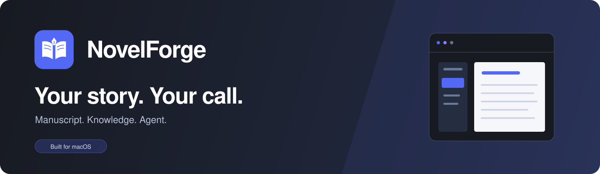
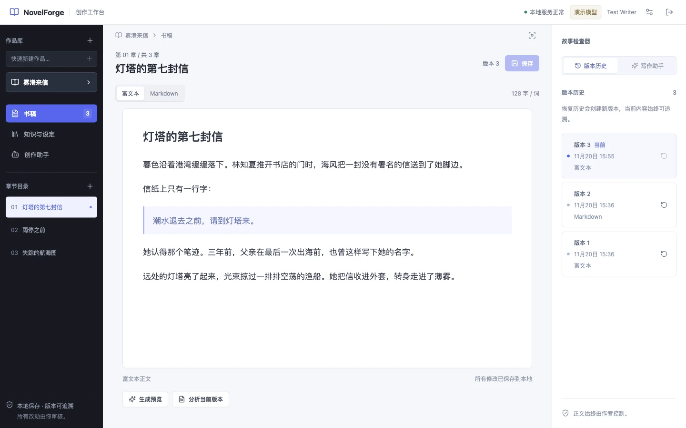
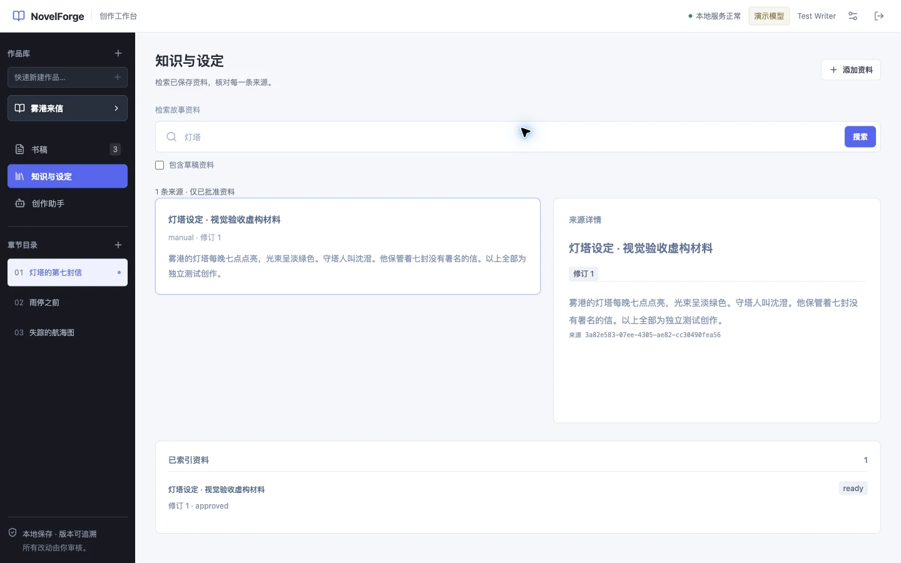
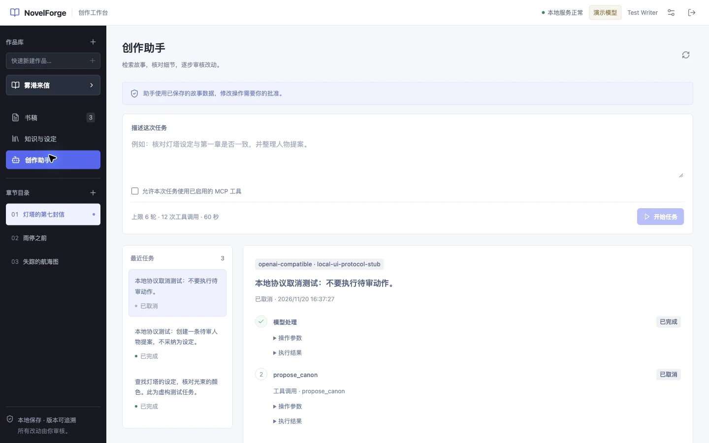
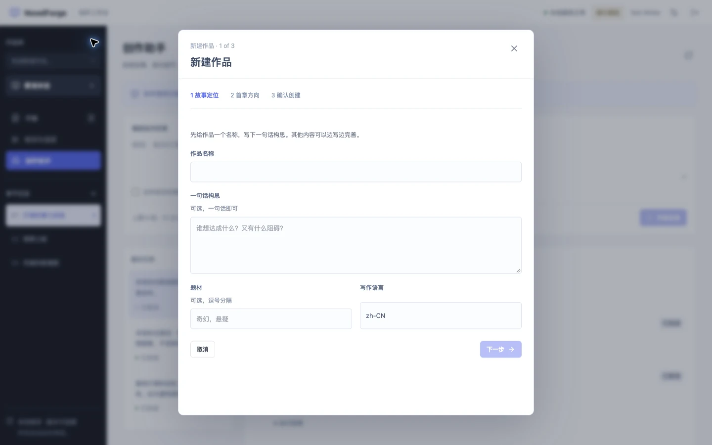
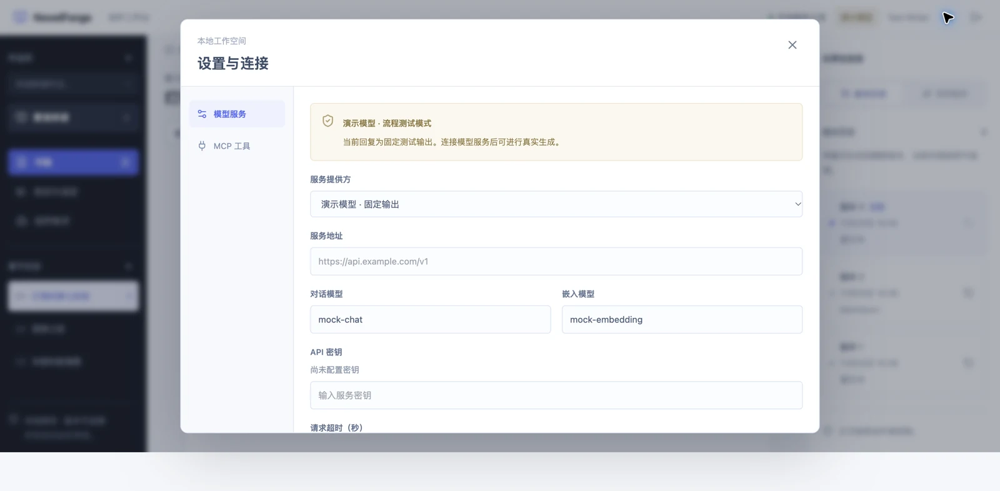
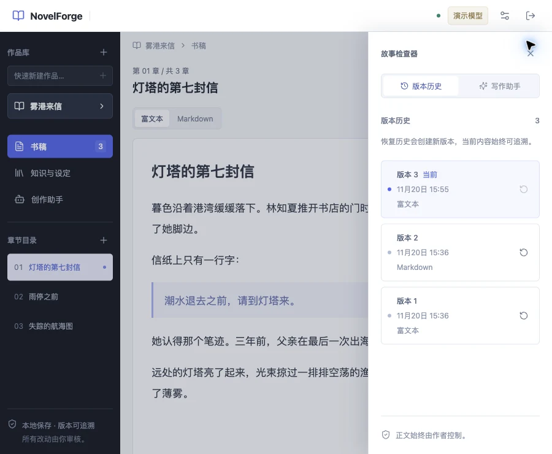

<p align="center">
  
</p>

<h3 align="center">A macOS writing workspace for manuscripts, story knowledge, and an author-controlled agent</h3>

<p align="center">
  Keep your chapters and story facts together. Retrieve the details you need, inspect the assistant’s steps, and decide which changes become part of your story.
</p>

<p align="center">
  <b>English</b> | <a href="README.zh-CN.md">简体中文</a>
</p>

<p align="center">
  <a href="https://github.com/sskystack/NovelForge/actions/workflows/ci.yml"></a>
  <a href="docs/RELEASE_0.2.1.md"></a>
  <a href="apps/desktop/README.md"></a>
  <a href="https://github.com/sskystack/NovelForge/stargazers"></a>
</p>

<p align="center">
  <a href="#core-features">Features</a> · <a href="#ui-preview">Preview</a> · <a href="#quick-start">Quick start</a> · <a href="#documentation">Documentation</a> · <a href="https://www.figma.com/design/DogOPwqSYvOJtzXnsGXSZS">Figma</a>
</p>

---

## Why NovelForge

Long-form fiction accumulates more than chapters. Character histories, world rules, unresolved threads, and earlier drafts all shape what can happen next. When those details live across documents and chat windows, keeping them consistent takes work.

- **Story context gets scattered.** Bring manuscripts and searchable reference material into one workspace.
- **Suggestions can conflict with established facts.** Keep retrieved sources and revisions visible so you can check the evidence.
- **An AI edit should be a decision.** Preview generated prose, review tool actions, and keep accepted canon separate from proposals.
- **Revisions need a history.** Save immutable chapter versions and restore an older version without erasing what came after it.

You write the story and approve its facts. The assistant helps retrieve context, inspect details, and prepare suggestions.

---

## Core features

### 1. A writing desk with version history

- **Write in rich text or Markdown.** Navigate projects and chapters, enter focus mode, and save with `⌘S`.
- **Start with a clear direction.** A three-step wizard captures your premise, an optional first chapter, and a review before creation.
- **Keep every saved revision.** Inspect chapter history; restoring creates a new version. Unsaved-change guards and version checks help prevent accidental overwrites.
- **Review AI prose before adoption.** Generation produces a preview; accepting it is an explicit author action.

<p align="center">
  
  <br/>
  <sub>Graphite navigation, a white manuscript surface, and a separate story inspector.</sub>
</p>

---

### 2. Searchable story knowledge with RAG

- **Add your reference material.** Ingest text documents and manage indexed source revisions.
- **Find relevant details.** Retrieval combines lexical and vector signals, with optional SQLite FTS5 acceleration.
- **Check the source.** Search results expose the passage, source identifier, and revision in a dedicated detail panel.
- **Control the context.** Retrieval respects novel ownership, source visibility, and current chapter versions. Recent-chapter context excludes the current and future chapters.

<p align="center">
  
  <br/>
  <sub>Read the retrieved passage and its provenance before relying on it.</sub>
</p>

---

### 3. An inspectable agent, function calling, and MCP

- **Follow the execution.** Persistent tasks record model steps, function calls, observations, and cited sources.
- **Keep tasks bounded.** Runs have round, tool-call, time, and token budgets, with cancellation and visible terminal states.
- **Approve consequential actions.** Write tools require approval bound to the exact arguments. A canon proposal still needs separate author adoption.
- **Connect trusted MCP servers.** The official SDK supports stdio and Streamable HTTP. Connections start disabled with empty allowlists; external calls require explicit approval and per-run opt-in.
- **Choose your model service.** Configure an OpenAI-compatible endpoint, chat model, embedding model, and your own key. The default mock provider is a deterministic workflow demo.

<p align="center">
  
  <br/>
  <sub>Records show what completed and what was cancelled. Screenshots use synthetic stories and local test providers.</sub>
</p>

NovelForge currently acts as an **MCP client**. An MCP server exposing your library, ACP agent connections, and a community Skill marketplace are not implemented.

---

### 4. Local storage and a self-contained desktop runtime

- **Keep projects on your Mac.** The app bundles its local API and uses SQLite; end users do not need to run Python, a database server, or Docker.
- **Preserve data across upgrades.** Recognized legacy databases are backed up before versioned migrations. Project archives support engineering backup and import/export.
- **Keep the service local.** The sidecar uses a dynamic loopback port and per-launch authorization, and shuts down with the app.
- **Know when data leaves the device.** Real model requests send selected context to your configured provider; MCP tools can send arguments to their configured servers.

Stored credentials are masked in API responses but remain plaintext in the permission-restricted local database. macOS Keychain storage is still planned. A configured stdio server runs with your OS privileges; the approval gateway is not an OS sandbox.

---

## UI preview

<details>
<summary><b>More screens: project setup, model settings, and smaller Mac windows</b></summary>

### Project setup

Capture the story direction, optionally create an empty first chapter, then review what will be saved. This step does not call a model.

<p align="center">
  
</p>

### Model settings

Manage your model endpoint and credentials in the workspace. The screen clearly identifies the offline demo provider.

<p align="center">
  
</p>

### Smaller Mac windows

The layout has been checked at widths of 1440, 1100, and 900 pixels. At narrower widths, open the inspector explicitly while the manuscript scrolls independently.

<p align="center">
  
</p>

The current app UI is primarily Simplified Chinese. This English README does not imply complete English UI localization. Editable designs: [Figma](https://www.figma.com/design/DogOPwqSYvOJtzXnsGXSZS); implementation notes: [UI design](docs/UI_DESIGN.md).

</details>

---

## Quick start

### Desktop app · macOS Apple Silicon

The current source version is **0.2.1**. A DMG has been built and checked locally, including its icon and nested signatures. A public GitHub Release has not yet been published; use the source build below. If you already have the verified DMG, open it and drag `NovelForge.app` into Applications.

The bundle is ad-hoc signed. Developer ID signing, Apple notarization, and clean-machine distribution validation remain unfinished. **macOS is the only maintained platform**; Intel Macs have not been validated, and historical Android/Windows scaffolds are unsupported.

### Build and run from source

Prerequisites: an Apple Silicon Mac, Xcode Command Line Tools, a Rust toolchain, Python 3.12+, [uv](https://docs.astral.sh/uv/), and Node.js 20.19+ or 22.12+ with npm.

```sh
git clone https://github.com/sskystack/NovelForge.git
cd NovelForge
./scripts/setup.sh
npm ci --prefix apps/desktop
./script/build_and_run.sh
```

The run script builds the frozen API and native app, verifies bundle integrity, and launches with ignored `.local-data/` development storage. To create a standalone DMG:

```sh
npm run tauri:build --prefix apps/desktop -- --bundles dmg
uv run --project apps/api python scripts/verify_macos_bundle.py \
  apps/desktop/src-tauri/target/release/bundle/dmg/NovelForge_0.2.1_aarch64.dmg
```

Installed-app data normally lives in `~/Library/Application Support/dev.novelforge.desktop`. See the [desktop guide](apps/desktop/README.md) for storage, logs, and isolated test instances.

### Your first story

1. Create a local account and a project; optionally add the first chapter in the wizard.
2. Write and save a chapter. Add reference text under **知识与设定** (Knowledge).
3. Try **创作助手** (Assistant) with the demo provider, or configure a real model under **设置与连接** (Settings).
4. Inspect sources and tool arguments. Explicitly approve actions and accept the changes you want to keep.

---

## Verification and current limits

The 0.2.1 checks completed on **2026-11-20**:

| Check | Result |
| --- | --- |
| API / frontend tests | 118 / 48 passed |
| Deterministic retrieval regressions | 6/6 passed |
| Frozen-sidecar workflows | 16 passed, including actual MCP SDK discovery and calls |
| Native installed app | Login, saved versions, retrieval, agent execution, and settings checked |
| Packaging | Apple Silicon DMG, icon resources, and deep strict signatures checked |

Tests use synthetic manuscripts, deterministic mocks, and local protocol fixtures. They establish workflow behavior, not commercial-model writing quality. Large-corpus ANN retrieval, reranking, and real semantic-quality evaluation remain open. Interrupted ambiguous tool effects are not automatically replayed. Project archives are backups, not sanitized EPUB/PDF publication exports. Cloud sync and hosted SaaS are outside the current release scope.

See [0.2.1 release notes](docs/RELEASE_0.2.1.md) and the [Agent/RAG/MCP gap analysis](docs/AGENT_GAP_ANALYSIS.md) for evidence and limitations.

## Documentation

| Topic | Documents |
| --- | --- |
| Product and design | [Requirements](docs/PRD.md) · [UI design](docs/UI_DESIGN.md) · [Figma](https://www.figma.com/design/DogOPwqSYvOJtzXnsGXSZS) |
| Architecture and data | [Architecture](docs/ARCHITECTURE.md) · [Database](docs/DATABASE.md) · [API](docs/API.md) |
| Agent and knowledge | [Specification](docs/AGENT_SPEC.md) · [Implementation and gaps](docs/AGENT_GAP_ANALYSIS.md) |
| Development and packaging | [Development](docs/DEVELOPMENT.md) · [Desktop](apps/desktop/README.md) · [Icon packaging](docs/MACOS_ICON_PACKAGING.md) |
| Research and planning | [Open-source adoption](docs/OPEN_SOURCE_ADOPTION.md) · [Roadmap](docs/ROADMAP.md) |

Older planning documents retain historical proposals. The macOS-only policy and runtime invariants in [AGENTS.md](AGENTS.md) govern current development.

## Contributing and acknowledgements

Use [Issues](https://github.com/sskystack/NovelForge/issues) for reproducible bugs and focused feature proposals. Read [AGENTS.md](AGENTS.md) before contributing, keep real manuscripts and secrets out of reports, and include checks relevant to your change.

The README’s presentation is inspired by [Agentero](https://github.com/poco-ai/Agentero). Screenshots and branding are NovelForge’s own. Writing-workflow research and attributions are recorded in [Open-source adoption](docs/OPEN_SOURCE_ADOPTION.md).

If NovelForge helps your writing, a [GitHub star](https://github.com/sskystack/NovelForge/stargazers) helps others find it.

## License status

Apache-2.0 is the intended license, but **no LICENSE file has been added yet**. This README does not grant that license; verify the repository’s license status before redistributing or reusing its code.
