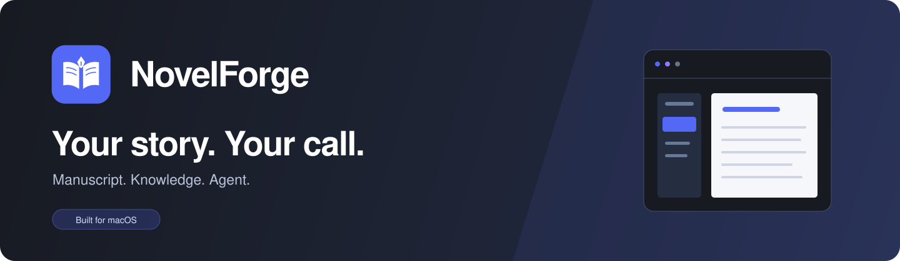
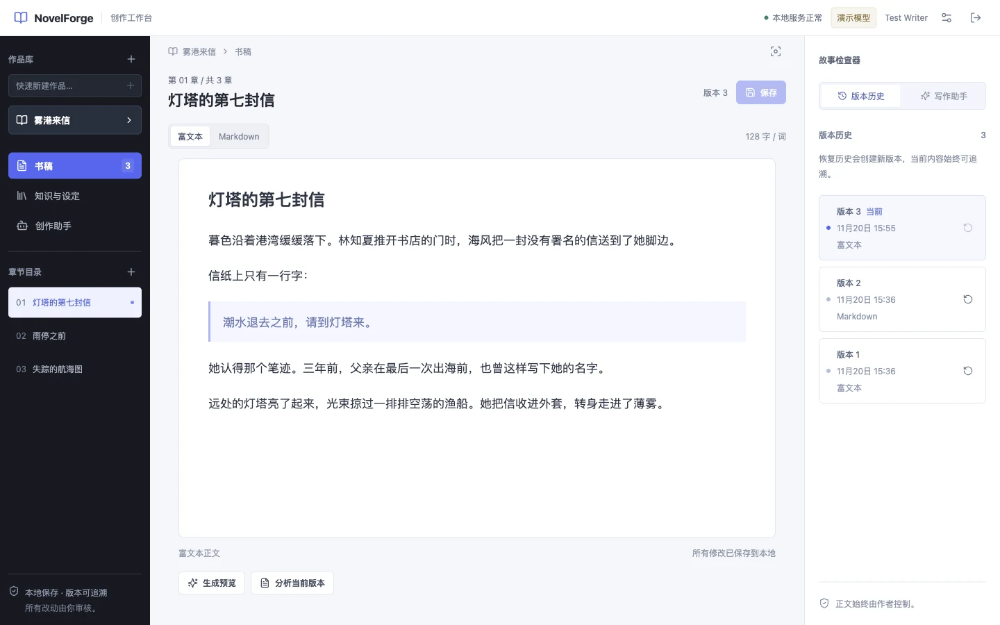
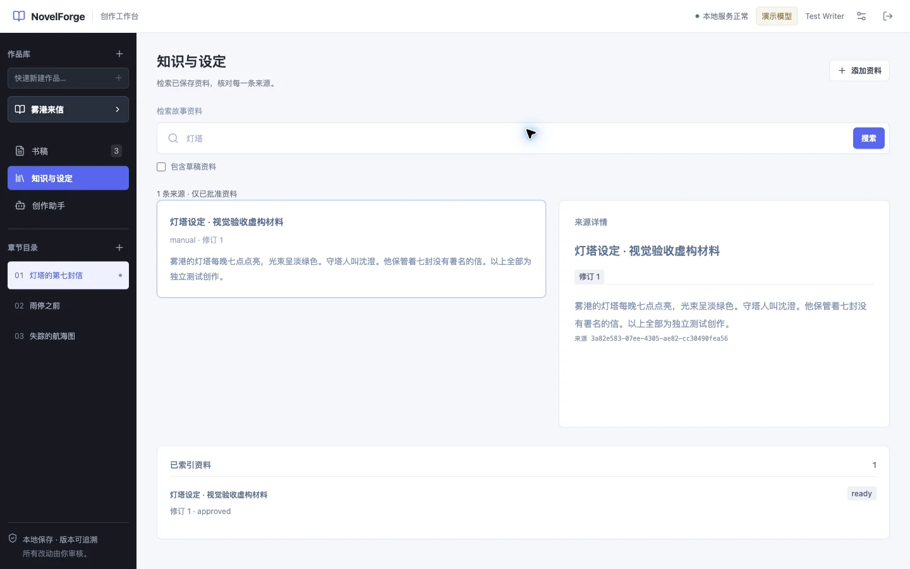
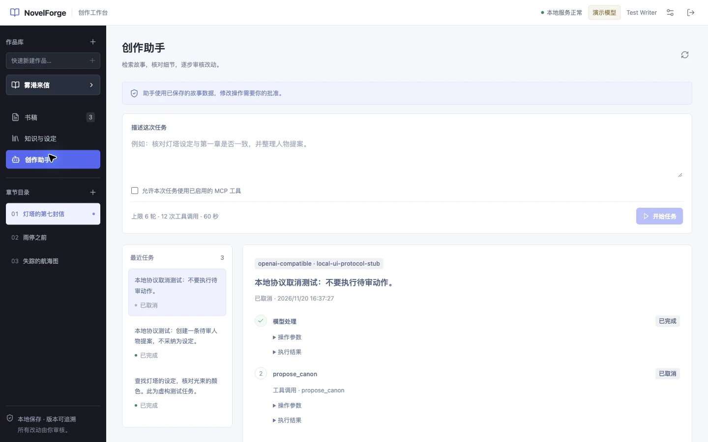
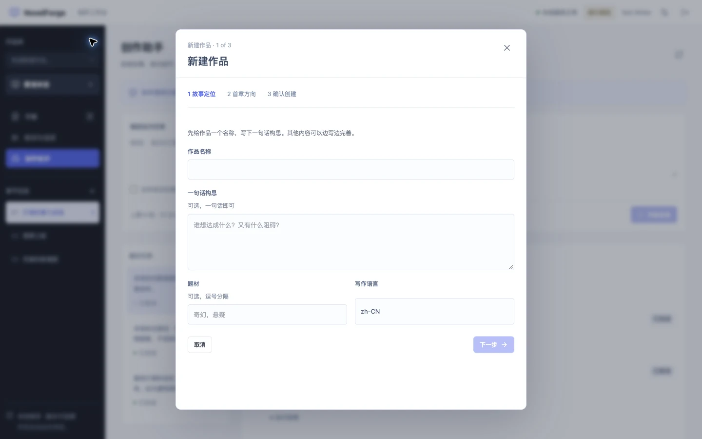
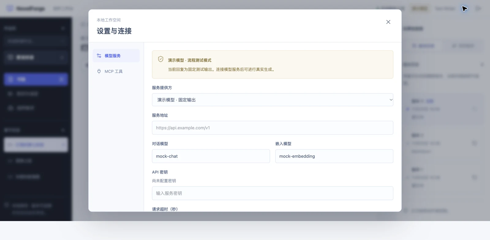
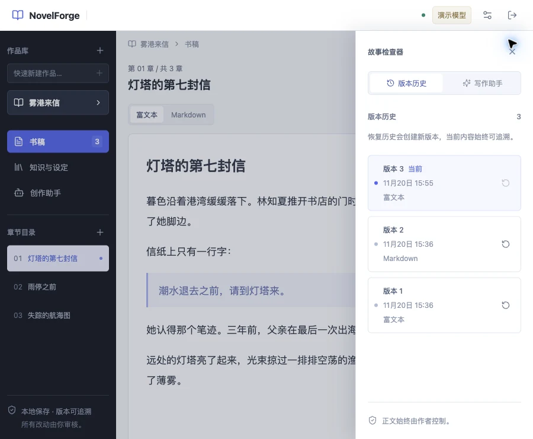

<p align="center">
  
</p>

<h3 align="center">把书稿、故事资料和可审核的 Agent 放在一起的 macOS 创作工作台</h3>

<p align="center">
  在同一个空间写章节、查设定、核对助手的执行过程。哪些建议进入正文，哪些事实成为正式设定，始终由你决定。
</p>

<p align="center">
  <a href="README.md">English</a> | <b>简体中文</b>
</p>

<p align="center">
  <a href="https://github.com/sskystack/NovelForge/actions/workflows/ci.yml"></a>
  <a href="docs/RELEASE_0.2.1.md"></a>
  <a href="apps/desktop/README.md"></a>
  <a href="https://github.com/sskystack/NovelForge/stargazers"></a>
</p>

<p align="center">
  <a href="#核心功能">核心功能</a> · <a href="#界面预览">界面预览</a> · <a href="#快速开始">快速开始</a> · <a href="#项目文档">项目文档</a> · <a href="https://www.figma.com/design/DogOPwqSYvOJtzXnsGXSZS">Figma 设计稿</a>
</p>

---

## 为什么做 NovelForge

写长篇小说，积累的不只是章节。人物经历、世界规则、尚未回收的线索和旧稿，都影响着下一幕能发生什么。这些资料散落在文档和聊天窗口里，保持一致就变成了额外工作。

- **上下文散落各处。** 把书稿与可检索的参考资料放到同一工作台。
- **AI 建议可能违背已有设定。** 展示检索来源和修订版本，让作者有据可查。
- **改稿应该是作者的决定。** 生成先预览，工具操作先审核，提案与正式设定分开。
- **修改需要留下来路。** 保存不可变章节版本，恢复旧稿也不抹去后续历史。

你负责创作和判断故事事实，助手负责检索上下文、核对细节和准备建议。

---

## 核心功能

### 1. 带版本历史的写作工作台

- **富文本与 Markdown 写作。** 管理作品和章节，进入专注模式，用 `⌘S` 保存。
- **从清晰的故事方向开始。** 三步向导收集故事定位、可选首章，并在创建前确认。
- **保留每次保存的版本。** 查看章节历史；恢复会创建新版本。未保存导航保护和版本校验帮助避免意外覆盖。
- **AI 正文先预览再采纳。** 生成结果不会直接替换书稿，需要作者明确接受。

<p align="center">
  
  <br/>
  <sub>石墨色导航、白色正文页，以及独立的故事检查器。</sub>
</p>

---

### 2. 有来源可查的故事知识库与 RAG

- **整理自己的参考资料。** 导入文本资料，管理已索引来源和修订版本。
- **检索相关故事细节。** 融合词法与向量信号，并支持可选的 SQLite FTS5 加速。
- **查看命中依据。** 在来源详情中核对段落、来源标识和修订版本。
- **控制进入上下文的内容。** 检索遵守小说归属、资料可见性与当前章节版本；近期章节上下文排除当前章和未来章节。

<p align="center">
  
  <br/>
  <sub>先读命中的原文与出处，再判断它能支持什么建议。</sub>
</p>

---

### 3. 可查看过程的 Agent、Function Calling 与 MCP

- **查看助手的执行过程。** 持久化任务记录模型步骤、函数调用、工具观察结果和引用来源。
- **给任务设定边界。** 限制轮数、工具调用次数、时间和 token 预算，支持取消与明确的结束状态。
- **审核会产生改动的操作。** 写工具审批绑定确切参数；正式设定提案仍需作者单独采纳。
- **连接可信的 MCP 服务。** 使用官方 SDK，支持 stdio 与 Streamable HTTP。连接默认禁用、白名单默认空；外部工具调用需要明确审批，并在本次任务中主动启用。
- **配置自己的模型服务。** 设置 OpenAI 兼容地址、对话模型、嵌入模型和 API 密钥。默认 mock 是固定输出的流程演示。

<p align="center">
  
  <br/>
  <sub>记录区分已完成与已取消的操作。截图使用虚构故事和本地测试模型。</sub>
</p>

NovelForge 当前是 **MCP 客户端**。向外提供小说资料的 MCP 服务端、ACP Agent 连接、社区 Skill 市场尚未实现。

---

### 4. 本地存储与完整桌面运行链路

- **项目保存在 Mac 上。** 桌面应用自带本地 API，使用 SQLite；普通用户无需单独运行 Python、数据库服务或 Docker。
- **升级时保留资料。** 对已识别的旧数据库先备份再执行版本迁移；工程归档支持备份及导入导出。
- **服务只在本机运行。** sidecar 使用动态 loopback 端口和每次启动的请求凭证，随应用退出。
- **明确资料何时离开本机。** 使用真实模型时，选入的上下文会发送到配置的模型服务；MCP 工具也可能将参数发送给对应服务。

凭据在 API 响应中隐藏，但当前仍以明文保存在权限受限的本地数据库，系统钥匙串尚未接入。配置的 stdio 服务以你的系统权限执行；工具审批网关不提供操作系统沙箱隔离。

---

## 界面预览

<details>
<summary><b>展开查看更多：新建作品、模型设置与小尺寸 Mac 窗口</b></summary>

### 新建作品

填写故事方向、按需创建空白首章，再确认要保存的内容。这一步不调用模型。

<p align="center">
  
</p>

### 模型设置

在工作台内管理模型地址与凭据，页面明确标示当前是否处于离线演示模式。

<p align="center">
  
</p>

### 小尺寸 Mac 窗口

已检查 1440、1100 和 900 像素宽度。较窄窗口中按需打开检查器，正文区域独立滚动。

<p align="center">
  
</p>

应用界面目前以简体中文为主；英文 README 不代表已完成英文界面本地化。可编辑设计稿见 [Figma](https://www.figma.com/design/DogOPwqSYvOJtzXnsGXSZS)，实现记录见 [UI 设计文档](docs/UI_DESIGN.md)。

</details>

---

## 快速开始

### 桌面版 · macOS Apple Silicon

当前源码版本为 **0.2.1**。已在本地构建并检查 DMG、应用图标及嵌套签名，尚未发布公开 GitHub Release；可按下方步骤从源码构建。如果已有经过验证的 DMG，打开后将 `NovelForge.app` 拖入 Applications 即可安装。

当前使用 ad-hoc 签名，Developer ID 签名、Apple 公证和干净机器分发验证尚未完成。**仅维护 macOS**；Intel Mac 尚未验证，历史 Android/Windows 脚手架不再提供支持。

### 从源码构建并运行

准备一台 Apple Silicon Mac，并安装 Xcode Command Line Tools、Rust 工具链、Python 3.12+、[uv](https://docs.astral.sh/uv/)，以及带 npm 的 Node.js 20.19+ 或 22.12+。

```sh
git clone https://github.com/sskystack/NovelForge.git
cd NovelForge
./scripts/setup.sh
npm ci --prefix apps/desktop
./script/build_and_run.sh
```

运行脚本会构建冻结 API 和原生应用、验证包完整性，再使用被 Git 忽略的 `.local-data/` 开发资料启动。需要独立 DMG 时执行：

```sh
npm run tauri:build --prefix apps/desktop -- --bundles dmg
uv run --project apps/api python scripts/verify_macos_bundle.py \
  apps/desktop/src-tauri/target/release/bundle/dmg/NovelForge_0.2.1_aarch64.dmg
```

正常安装的应用将数据保存在 `~/Library/Application Support/dev.novelforge.desktop`。存储位置、日志和隔离测试实例说明见 [桌面开发指南](apps/desktop/README.md)。

### 开始第一个故事

1. 创建本地账户和作品，可在向导中顺便添加首章。
2. 写下并保存章节，在「知识与设定」中添加参考文本。
3. 在「创作助手」试用演示模型，或在「设置与连接」中配置真实模型。
4. 核对引用来源与工具参数，明确审批操作，再采纳想保留的修改。

---

## 验证情况与当前边界

**2026-11-20** 完成的 0.2.1 验证：

| 检查 | 结果 |
| --- | --- |
| API / 前端测试 | 118 / 48 项通过 |
| 固定检索回归 | 6/6 通过 |
| 冻结 sidecar 工作流 | 16 项通过，含真实 MCP SDK 工具发现和调用 |
| 已安装原生应用 | 登录、保存版本、检索、Agent 执行与设置已检查 |
| 打包 | Apple Silicon DMG、图标资源及深度严格签名检查通过 |

测试使用虚构书稿、固定 mock 和本地协议替身，验证流程行为，不代表商业模型写作质量。大规模 ANN 检索、重排和真实语义质量评测仍待完成。中断且执行结果不明确的工具操作不会自动重放。工程归档是备份，不是经过清理的 EPUB/PDF 出版导出。云同步与托管 SaaS 不属于当前版本范围。

完整证据与限制见 [0.2.1 发布记录](docs/RELEASE_0.2.1.md)和 [Agent/RAG/MCP 差距分析](docs/AGENT_GAP_ANALYSIS.md)。

## 项目文档

| 主题 | 文档 |
| --- | --- |
| 产品与设计 | [产品需求](docs/PRD.md) · [UI 设计](docs/UI_DESIGN.md) · [Figma](https://www.figma.com/design/DogOPwqSYvOJtzXnsGXSZS) |
| 架构与数据 | [架构](docs/ARCHITECTURE.md) · [数据库](docs/DATABASE.md) · [API](docs/API.md) |
| Agent 与知识 | [能力规格](docs/AGENT_SPEC.md) · [实现与差距](docs/AGENT_GAP_ANALYSIS.md) |
| 开发与打包 | [开发指南](docs/DEVELOPMENT.md) · [桌面指南](apps/desktop/README.md) · [图标打包](docs/MACOS_ICON_PACKAGING.md) |
| 调研与规划 | [开源项目借鉴](docs/OPEN_SOURCE_ADOPTION.md) · [路线图](docs/ROADMAP.md) |

早期规划文档保留了历史提案。当前开发以 [AGENTS.md](AGENTS.md) 的 macOS-only 决策及运行时约束为准。

## 参与贡献与致谢

欢迎通过 [Issues](https://github.com/sskystack/NovelForge/issues) 提交可复现的问题和具体功能建议。贡献前请阅读 [AGENTS.md](AGENTS.md)，不要在报告中上传真实书稿或密钥，并提供与修改相关的检查结果。

README 的展示结构参考了 [Agentero](https://github.com/poco-ai/Agentero)，截图与品牌资源均为 NovelForge 自有。小说创作流程的调研来源与借鉴记录见 [开源项目借鉴](docs/OPEN_SOURCE_ADOPTION.md)。

如果 NovelForge 对你的创作有帮助，欢迎点一个 [GitHub Star](https://github.com/sskystack/NovelForge/stargazers)，让更多作者发现它。

## 许可证状态

项目计划采用 Apache-2.0，但**尚未添加 LICENSE 文件**。本 README 不构成该许可证的授权；复用或分发代码前请核实仓库实际许可证状态。
