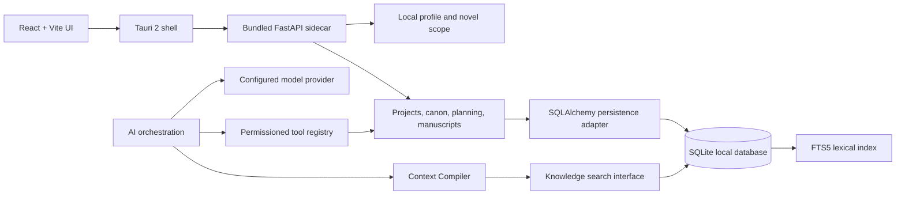

# NovelForge — Architecture Specification

> **Owner decision — 2026-11-20: macOS only.** Android, Windows and other platforms are no longer maintained, built or released. Historical multi-platform plans below do not authorize new work or create acceptance gates. Read the repository `AGENTS.md` first; current Agent/RAG/MCP implementation evidence is in `docs/AGENT_GAP_ANALYSIS.md`.

**Historical product direction (superseded above):** Desktop-Local First. Windows and macOS desktop are the first release targets. The self-hosted, SaaS and Android profiles below are deferred and are not requirements for the next development issues.

## 1. Architecture style

Use a modular monolith with explicit domain boundaries. The desktop application contains the shared React/Vite UI and supervises one bundled local FastAPI sidecar. Domain services use SQLAlchemy and explicit persistence/search interfaces. The desktop source of truth is a file-backed SQLite database under the OS user application-data directory.

This target is not yet implemented. At audited revision `27360af`, the repository has no Tauri shell or packaged sidecar, defaults to PostgreSQL, and has no FTS5 index. The transition requires reviewable schema and migration design before implementation; do not describe the target as existing behavior.

## 2. Target components

## 3. Module boundaries

- `identity`: local user/profile sessions and authorization. Desktop must not require remote auth.
- `projects`: novel lifecycle, settings, export/import and backup operations.
- `canon`: characters, states, relationships, locations, factions, world rules and immutable approval revisions.
- `planning`: nested outlines, story events, timeline and foreshadowing.
- `manuscripts`: chapters, TipTap/Markdown snapshots and optimistic concurrency.
- `knowledge`: source documents, chunking, embeddings, FTS5 and provenance lifecycle.
- `ai`: provider interfaces, model settings, Context Compiler and generation sessions.
- `tools`: typed schemas, per-novel permission checks, timeout and audit; no arbitrary SQL or shell.
- `consistency`: deterministic evidence-linked checks and review state.
- `desktop`: Tauri host, sidecar startup/health/shutdown, secure local channel and installer metadata.

These boundaries describe the desired modular monolith. Only the API, web, domain packages through the context compiler, and database test setup currently exist.

## 4. Local persistence and retrieval

- SQLite is the planned production database for desktop-local mode. Use a versioned migration path and a backup before upgrade; preserve user data outside the installation directory.
- Repository/service code must not depend on PostgreSQL-only SQL. Keep dialect-specific search behind adapters.
- Use SQLite FTS5 for local lexical search after verifying the SQLite library shipped with the Python sidecar includes FTS5.
- Preserve `novel_id`, source identity, source revision, content hash and chunker version in every retrieval path.
- Keep embeddings derived and rebuildable. The current exact-cosine prototype is O(ND) and must be benchmarked before its supported corpus size is set. `sqlite-vec` is an option only after native packaging and migration costs are demonstrated to be worthwhile.
- Do not remove vector retrieval, provenance or the Context Compiler to make SQLite easier. Do not claim parity with pgvector.

## 5. Local API and desktop security

- Tauri starts the API sidecar on loopback only and waits for a health/readiness handshake before loading the UI.
- Select an ephemeral local port and a per-launch local credential or equivalent authenticated IPC mechanism; never expose a listener on `0.0.0.0` by default.
- Validate Origin/CSRF and authorize every novel-owned lookup at the service boundary.
- Sidecar startup, bounded crash recovery, shutdown, stale process cleanup and redacted logs must be tested on Windows and macOS.
- Keep API keys in an OS-appropriate local secret store or protected application settings. Never place them in Vite variables, client bundles, logs or project archives.
- External model providers are optional user-configured network services; project storage and non-AI authoring remain local.

## 6. Data flows

### Chapter generation

1. The local API validates the user profile, novel and chapter scope.
2. The Context Compiler loads the chapter, outline, canon and effective story-time state.
3. Knowledge search returns bounded snippets with novel and source-version provenance.
4. The provider interface generates a structured draft and tool requests.
5. The tool registry validates every call and only permits reads, drafts or proposals under its tier.
6. Generation output and source manifest are stored locally as a preview.
7. Explicit user acceptance creates a chapter version using optimistic concurrency.

### Chapter analysis

1. Save an immutable chapter version.
2. Run local idempotent analysis keyed by chapter-version ID.
3. Persist candidate summaries, events, state changes and conflicts as proposals.
4. User reviews candidates; approval updates canon and revision history transactionally.
5. Re-index the accepted source. Do not retire prior active chunks until replacement indexing succeeds.

## 7. Context precedence

1. Approved canon and state effective at the requested story time.
2. Approved story events and timeline facts.
3. Relevant approved summaries.
4. Relevant approved chapter text.
5. Draft material only when explicitly requested.
6. Model inference, always labeled separately.

Conflicting approved facts must produce an explicit conflict warning with both sources. Do not silently choose a value. The current NF-012 code does not yet implement this conflict rule; it is tracked as an acceptance gap.

## 8. Desktop release and deferred profiles

### Current target

- Windows x64 installer (`.exe`) and macOS installer (`.dmg`); packaging/signing support is not present yet.
- No Python, Node.js, PostgreSQL or Docker requirement for end users.
- Data, backups and logs in per-user application-data storage, separate from installed binaries.
- User-configured external model providers; all non-AI project operations remain available locally.

### Deferred

- Self-hosted server deployment and its operations hardening (NF-018).
- Android client (NF-020).
- SaaS, multi-device sync, cloud database and distributed jobs.

Retain adapter boundaries so these profiles can be reconsidered later, but do not introduce cloud infrastructure into the desktop delivery path.

## 9. Key decisions

- Modular monolith; no microservices or required job queue for desktop v1.
- SQLite is the first-class local database target; PostgreSQL remains a deferred deployment option.
- FTS5 is the proposed local lexical index. Embeddings stay behind a provider/search adapter.
- TipTap JSON remains the canonical rich-text representation; Markdown is a tested edit/import/export format.
- Project archives are portable snapshots and the backup/restore mechanism; archive import never overwrites an existing project.
- Canon approval remains human-authorized and append-only revision history remains mandatory.
