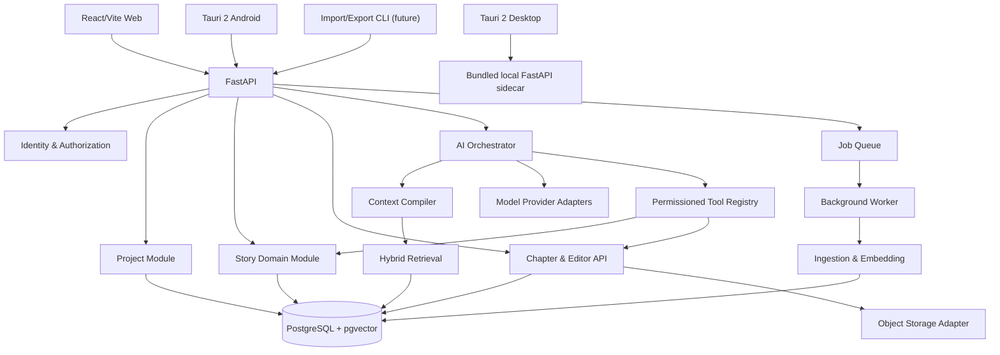

# NovelForge — Architecture Specification

## 1. Architecture style

Use a **modular monolith** with explicit domain boundaries. One deployable API application and one background worker may share the same Python packages. Avoid microservices until measured scale or independent deployment requirements justify them.

SaaS and self-hosted deployments use the same application image, migrations and domain services. Deployment-specific adapters provide object storage, secrets, email, quotas and tenant configuration.

## 2. High-level components

## 3. Backend modules

### identity
- Users, sessions, API credentials.
- Password hashing / OAuth integration.
- Authentication dependencies.
- Authorization policy.

### projects
- Novel lifecycle, project settings, membership.
- Project archive export/import.
- Enforces user-to-novel access.

### canon
- Characters, character states, relationships, locations, factions, world rules.
- Canon status and immutable revisions.
- Approval workflow.

### planning
- Nested outlines, story events, timeline and foreshadowing.
- Links between outline nodes and story entities.

### manuscripts
- Chapters, editor documents, versions, autosave.
- Markdown and TipTap JSON conversion.
- Optimistic concurrency.

### knowledge
- Document ingestion, chunking, embeddings.
- Full-text and vector search.
- Provenance and index lifecycle.

### ai
- Provider registry and model router.
- Prompt templates and structured output validation.
- Context Compiler.
- Generation sessions.
- Token/cost telemetry.

### tools
- Typed tool schemas.
- Permission checks.
- Per-tool timeout and rate limits.
- Audit records.
- No generic SQL or shell execution.

### consistency
- Deterministic rule checks.
- AI-assisted contradiction analysis.
- Evidence-backed issue records.

### jobs
- Background ingestion, embedding, chapter analysis, export and cleanup.
- Idempotent jobs and retry policy.

## 4. Frontend application areas

- Project dashboard
- World bible / canon editor
- Character and relationship views
- Plot outline and timeline
- Chapter editor with rich/Markdown mode
- AI side panel
- Retrieval source inspector
- Consistency issue inbox
- Settings: providers, models, export, privacy

## 5. Data flow: chapter generation

1. User requests an action for a novel and chapter.
2. API authenticates user and checks novel membership.
3. AI Orchestrator loads chapter, outline and writing preferences.
4. Context Compiler obtains canonical facts by structured queries.
5. Hybrid retrieval searches relevant narrative chunks, scoped to the novel.
6. Compiler resolves precedence and assembles bounded context with source IDs.
7. Model Router selects task-specific model.
8. Tool calls are validated and authorized individually.
9. Model returns structured draft and source references.
10. Server validates output and stores generation metadata.
11. UI presents preview; user accepts or edits.
12. Accepted text creates a new chapter version using optimistic concurrency.

## 6. Data flow: chapter commit and memory update

1. Save chapter version transactionally.
2. Enqueue an idempotent analysis job referencing immutable chapter version ID.
3. Generate summary, candidate events, state changes and possible contradictions.
4. Persist proposals as `proposed`; do not modify canon.
5. User reviews each proposal.
6. Approved proposals update canon/story state and create revisions in one transaction.
7. Enqueue re-index jobs for affected source versions.
8. Mark prior chunks inactive only after new embeddings are successfully written; maintain rollback/retry path.

Knowledge documents are immutable by source revision identity. Their content hash and chunker version make retries idempotent; a failed embedding run records failure while leaving the prior revision's active chunks searchable.

## 7. Context precedence

Use explicit source classes, not a single flat similarity score:

1. Approved current canon and current state at the requested story time.
2. Approved story events and timeline facts.
3. Relevant approved chapter summaries.
4. Relevant chapter text.
5. Draft / unapproved material, only when explicitly requested.
6. AI inference, clearly labeled as inference.

When two approved canon facts conflict, do not silently choose one. Return a conflict requiring author resolution. Temporal facts must be filtered by effective story time.

## 8. Isolation and authorization

- Every novel-owned row has `novel_id`.
- Repositories require a `NovelScope` object derived from authenticated membership.
- Never trust a client-supplied `novel_id` without checking membership.
- RAG SQL filters by `novel_id` and authorized user before vector similarity ranking.
- Tool context includes immutable `user_id`, `novel_id`, permission set and correlation ID.
- Consider PostgreSQL Row-Level Security as defense in depth for SaaS.
- Tests must attempt cross-project reads through REST, RAG and tools.

## 9. Deployment profiles

### Self-hosted
- Native install/run scripts; Docker is not part of the supported default setup.
- Run FastAPI, worker and PostgreSQL/pgvector as ordinary host processes/services. Provide OS-specific service instructions.
- Local file storage by default; user supplies model API keys or configures a local provider.
- One admin bootstrap flow; documented backup and restore.

### Desktop local mode
- Tauri 2 packages the shared React/Vite UI for Windows and macOS.
- Bundle the Python API as a platform-specific sidecar executable; supervise its lifecycle.
- Use SQLite for local single-user data and FTS5 for lexical retrieval. No PostgreSQL or Redis installation required.
- Store data in OS-standard per-user application data directories; provide backup/export and safe migrations.
- Desktop may optionally connect to a remote SaaS/self-hosted API.

### Android
- Tauri 2 Android package; signed APK for release.
- Android connects to a remote NovelForge API initially; do not embed the Python server or PostgreSQL on Android.
- Store auth tokens using OS secure storage. Offline sync is a later milestone.

### SaaS
- Same application/domain code; managed PostgreSQL and object storage.
- Managed PostgreSQL and object storage.
- Tenant quotas and rate limits.
- Secret manager for provider credentials.
- Background worker scaling.
- RLS and tenant audit.
- Billing is out of MVP scope.

## 10. Key architectural decisions

- PostgreSQL + pgvector first; no separate vector database in MVP.
- Redis queue for production background work; local synchronous mode may be used for development.
- Provider-neutral internal chat and embedding interfaces.
- TipTap JSON is canonical rich-text representation; Markdown is an import/export/editing representation with tested round-trip behavior.
- Database is the online source of truth. Project archive is a portable snapshot, not a second live database.
- Embeddings are derived data and can be rebuilt.
